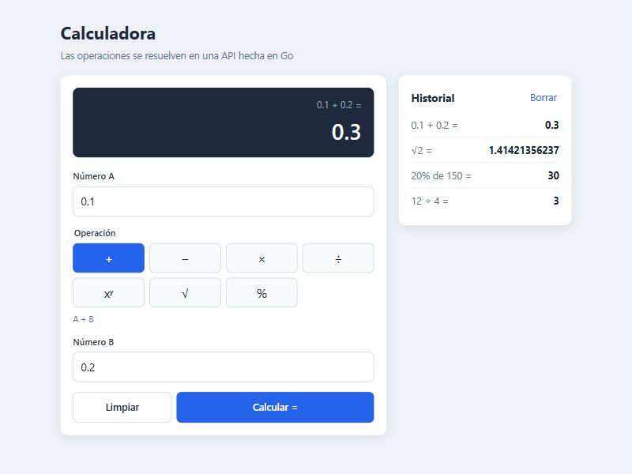
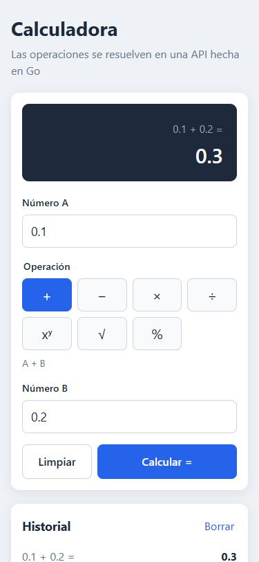

# Calculadora full-stack (React + Go)

Es una calculadora web que hice para una prueba técnica. El frontend está en React con TypeScript y las cuentas las hace un microservicio en Go. El navegador no calcula nada: valida lo que escribe el usuario y le pide el resultado a la API.

Tiene suma, resta, multiplicación, división, potencia, raíz cuadrada y porcentaje.

 

## Tecnologías

- Backend: Go, solo con la librería estándar (no tiene dependencias externas)
- Frontend: React 19 + TypeScript, con Vite
- Tests: `go test` en el backend, Vitest + Testing Library en el frontend
- Docker y docker-compose para levantar todo junto (nginx sirve el frontend)

## Estructura

```
.
├── backend/
│   ├── cmd/server/            main.go, levanta el servidor HTTP
│   ├── internal/calculator/   las operaciones matemáticas (no sabe nada de HTTP)
│   ├── internal/api/          handlers, rutas y middlewares (CORS y logs)
│   └── Dockerfile
├── frontend/
│   ├── src/
│   │   ├── api/               cliente que llama al backend
│   │   ├── components/        formulario, pantalla e historial
│   │   ├── hooks/             useCalculator: llamada a la API y estado de la pantalla
│   │   ├── utils/             parseo y formato de números
│   │   └── operations.ts      las operaciones disponibles (símbolo, nombre, ayuda)
│   ├── nginx.conf
│   └── Dockerfile
├── docs/                      informe de pruebas, reportes de cobertura y capturas
└── docker-compose.yml
```

## Cómo correrlo

Necesitas:

- Go 1.22 o más nuevo (uso las rutas con método de `http.ServeMux`, que llegaron en esa versión)
- Node 22.13 o más nuevo. Yo usé Node 24.
- Docker, solo si lo quieres correr con contenedores

### Backend

```bash
cd backend
go run ./cmd/server
```

Queda escuchando en http://localhost:8080. El puerto se cambia con la variable `PORT`, y `CORS_ORIGIN` define qué origen puede llamar a la API (por defecto `*`).

### Frontend

En otra terminal:

```bash
cd frontend
npm install
npm run dev
```

Después abrir http://localhost:5173. En `vite.config.ts` hay un proxy que manda todo lo que empieza con `/api` a `localhost:8080`, así que el backend tiene que estar corriendo. Si el backend está en otra URL se puede definir `VITE_API_URL`, por ejemplo en un archivo `frontend/.env.local`.

Para el build de producción está `npm run build` (queda en `frontend/dist`).

### Con Docker

Desde la raíz del repo:

```bash
docker compose up --build
```

- Frontend: http://localhost:3000
- API: http://localhost:8080

El contenedor del frontend es un nginx que sirve el build y reenvía `/api` al contenedor del backend, que es lo mismo que hace Vite en desarrollo.

## Tests

Backend:

```bash
cd backend
go test ./... -cover
```

Para ver la cobertura en el navegador:

```bash
go test ./... -coverprofile=coverage.out
go tool cover -html=coverage.out
```

Frontend:

```bash
cd frontend
npm test            # corre los tests una vez
npm run coverage    # tests + cobertura (el HTML queda en frontend/coverage)
npm run lint        # oxlint
```

Resultado de la última corrida:

| | Tests | Cobertura |
|---|---|---|
| Backend | 69, todos pasan | 100 % en `calculator`, 98,5 % en `api`, 84,6 % en total |
| Frontend | 68, todos pasan | 100 % |

El total del backend baja porque `main()` no tiene test (solo levanta el servidor). El informe completo, con lo que prueba cada archivo y las pruebas manuales que hice, está en [docs/INFORME_PRUEBAS.md](docs/INFORME_PRUEBAS.md). Los reportes HTML de cobertura están en `docs/coverage/`.

## API

Todas las operaciones son `POST`, reciben JSON y devuelven JSON.

| Ruta | Body de ejemplo | Calcula |
|---|---|---|
| `POST /api/add` | `{"a": 2, "b": 3}` | a + b |
| `POST /api/subtract` | `{"a": 2, "b": 3}` | a - b |
| `POST /api/multiply` | `{"a": 2, "b": 3}` | a × b |
| `POST /api/divide` | `{"a": 2, "b": 3}` | a ÷ b |
| `POST /api/power` | `{"a": 2, "b": 3}` | a elevado a la b |
| `POST /api/percentage` | `{"a": 20, "b": 150}` | el a % de b |
| `POST /api/sqrt` | `{"a": 16}` | raíz cuadrada de a |
| `GET /api/health` | no lleva | responde `{"status":"ok"}` |

Si la cuenta sale bien responde 200 con la operación, los números que recibió y el resultado:

```json
{"operation":"divide","a":10,"b":4,"result":2.5}
```

Si algo falla responde `{"error": "..."}` con alguno de estos códigos:

| Código | Cuándo |
|---|---|
| 400 | El body está mal: no es JSON, falta `a` o `b`, o alguno no es un número |
| 422 | El body está bien pero la cuenta no se puede hacer: división entre cero, raíz de un negativo, resultado que no es real o que es demasiado grande |
| 404 / 405 | Ruta que no existe o método equivocado. Estos los responde el router de Go directamente, en texto plano |

### Ejemplos

```bash
curl -X POST http://localhost:8080/api/add -H "Content-Type: application/json" -d '{"a": 2, "b": 3}'
# {"operation":"add","a":2,"b":3,"result":5}

curl -X POST http://localhost:8080/api/power -H "Content-Type: application/json" -d '{"a": 2, "b": 10}'
# {"operation":"power","a":2,"b":10,"result":1024}

curl -X POST http://localhost:8080/api/sqrt -H "Content-Type: application/json" -d '{"a": 144}'
# {"operation":"sqrt","a":144,"result":12}

curl -X POST http://localhost:8080/api/percentage -H "Content-Type: application/json" -d '{"a": 20, "b": 150}'
# {"operation":"percentage","a":20,"b":150,"result":30}

curl -X POST http://localhost:8080/api/divide -H "Content-Type: application/json" -d '{"a": 5, "b": 0}'
# 422 {"error":"no se puede dividir entre cero"}

curl -X POST http://localhost:8080/api/add -H "Content-Type: application/json" -d '{"a": 1}'
# 400 {"error":"falta el campo 'b'"}

curl -X POST http://localhost:8080/api/add -H "Content-Type: application/json" -d '{"a": "hola", "b": 2}'
# 400 {"error":"el campo 'a' debe ser un número válido"}
```

En Windows estos comandos funcionan tal cual en Git Bash. En PowerShell es más fácil usar `Invoke-RestMethod`:

```powershell
Invoke-RestMethod -Method Post -Uri http://localhost:8080/api/add -ContentType "application/json" -Body '{"a": 2, "b": 3}'
```

## Decisiones de diseño

### La lógica está solo en el backend

El paquete `calculator` tiene funciones del estilo `func(a, b float64) (float64, error)` y no importa nada de HTTP. El paquete `api` lee el JSON, valida que vengan los campos y llama a la función que corresponde. Así pude probar las cuentas con tests de tabla sin levantar ningún servidor, y los handlers por separado con `httptest`.

En el frontend no hay ninguna regla matemática. Revisa que lo escrito sea un número y nada más; si alguien divide entre cero, el error lo responde el backend y el frontend lo muestra. Preferí eso a tener la misma validación en dos lugares que después se pueden desincronizar.

### Go sin frameworks

Desde Go 1.22 el `http.ServeMux` de la librería estándar acepta el método en la ruta (`"POST /api/add"`) y responde 405 por su cuenta, así que no necesité Gin ni chi. El `go.mod` no tiene ningún `require`.

### Un endpoint por operación

Pensé en hacer un solo `POST /api/calculate` con la operación dentro del body, pero con un endpoint por operación la API se entiende mejor al leerla. Para no repetir código, los handlers se arman con dos funciones, `binaryHandler` (usa `a` y `b`) y `unaryHandler` (solo `a`), y en `router.go` cada operación ocupa una línea.

### 400 vs 422

Uso 400 cuando el pedido está mal armado y 422 cuando está bien armado pero la cuenta no tiene resultado. Así quien use la API puede distinguir entre "mandaste algo mal" y "eso no se puede calcular".

### Punteros en el request

Los campos del request son `*float64` y no `float64`. Si no, un `{"a": 5}` mandado a `/api/divide` llegaría con `b = 0` y la respuesta sería "no se puede dividir entre cero" en vez de "falta el campo 'b'".

### Infinito, NaN y -0

Con float64 hay cuentas que dan `+Inf` (por ejemplo 10^400) o `NaN` (como (-8)^0.5), y esos valores ni siquiera se pueden mandar en JSON. Todas las operaciones pasan por `checkResult`, que los convierte en un error 422 con un mensaje entendible. De paso también cambia -0 por 0, porque si no `-5 * 0` devolvería `-0`.

### Precisión de los decimales

El backend trabaja con float64 y no redondea: si se pide 0.1 + 0.2, la API devuelve 0.30000000000000004, que es el resultado real en punto flotante. El redondeo lo hace el frontend solo para mostrar (12 cifras significativas), por eso en pantalla aparece 0.3. Pensé en usar una librería de decimales en Go, pero con potencias y raíces se complicaba bastante y para esta calculadora no me pareció necesario.

### Proxy en vez de depender de CORS

En desarrollo Vite reenvía `/api` al backend, y en Docker lo hace nginx. El navegador siempre habla con el mismo origen y no aparecen problemas de CORS. Igual dejé un middleware de CORS chiquito en el backend (configurable con `CORS_ORIGIN`) por si alguien quiere llamar a la API desde otro dominio.

### Frontend

- `useCalculator` hace la llamada a la API y guarda el estado de la pantalla (vacía, cargando, resultado o error) y el historial. El estado de la pantalla es una unión discriminada de TypeScript, así no puede estar "cargando" y "con error" al mismo tiempo.
- `CalculatorForm` tiene los inputs y su validación. Los inputs son `type="text"` con `inputMode="decimal"` en vez de `type="number"`: así acepto coma decimal y muestro mis propios mensajes, y en el celular igual sale el teclado numérico.
- `ResultDisplay` y `History` solo muestran datos.
- Las operaciones se definen una sola vez en `operations.ts` como un `Record<Operation, ...>`. Si se agrega una operación nueva al tipo, TypeScript obliga a completar su símbolo y su nombre.
- Los botones de operación son radio buttons con estilo de botón. Se pueden usar con el teclado y un lector de pantalla lee "División" en lugar de "÷".

### Detalles chicos

- Los mensajes de error de Go van en minúscula porque es la convención, así que el frontend pone la primera letra en mayúscula con CSS (`::first-letter`).
- Con el backend apagado, el proxy responde 502 y al principio la app mostraba "El servidor respondió con un error (502)", que no ayuda mucho. Ahora 502, 503 y 504 se muestran como error de conexión.
- El servidor se apaga de forma ordenada cuando recibe SIGTERM (lo que manda `docker stop`), y el body de los pedidos tiene un límite de 1 KB.

## Supuestos

- Porcentaje es "el a % de b", o sea 20 % de 150 = 30. Hay calculadoras que lo interpretan distinto; me quedé con la forma más común.
- La raíz cuadrada solo usa `a`. Si mandan `b`, se ignora en vez de devolver error.
- El frontend acepta enteros y decimales con punto o con coma, pero no notación científica ni separador de miles. Ojo que "1.000" se lee como 1 y no como mil.
- El historial vive en memoria y guarda las últimas 10 operaciones, así que se pierde al recargar.
- No hay autenticación ni límite de pedidos porque no era parte de lo pedido.

## Cosas que mejoraría con más tiempo

- Que los 404 y 405 también salgan en JSON.
- Guardar el historial en `localStorage`.
- Poder encadenar operaciones usando el resultado como nuevo A.
- Tests end-to-end con Playwright contra el backend real.
- Un healthcheck en el docker-compose para que el frontend espere a que el backend esté listo.
- Un teclado en pantalla como el de una calculadora normal, además del formulario.
